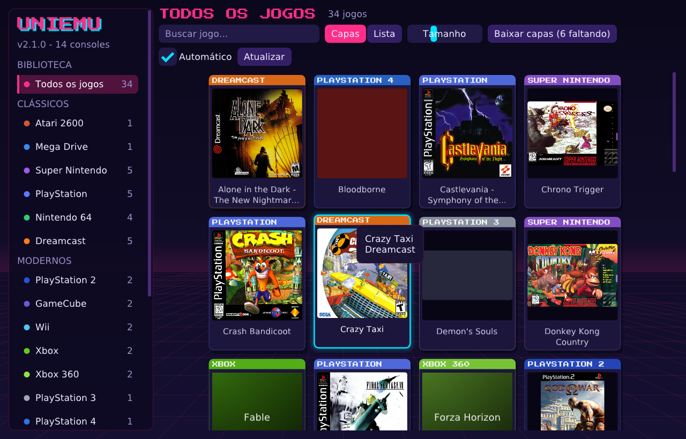
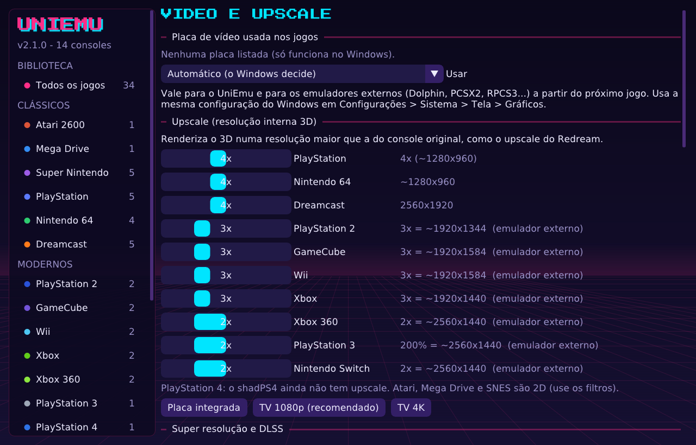
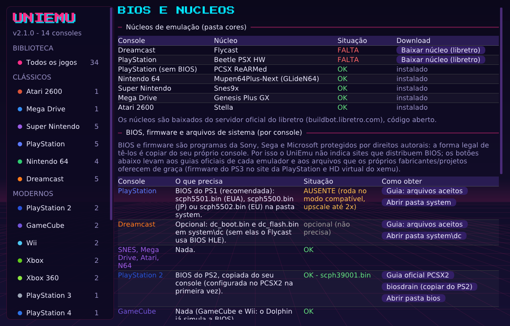

<p align="center">
  
</p>

<h1 align="center">UniEmu</h1>

<p align="center">
  <b>14 consoles num só lugar, com biblioteca de capas e upscale para todos.</b><br>
  Atari 2600 · Mega Drive · Super Nintendo · PlayStation · Nintendo 64 · Dreamcast<br>
  PlayStation 2 · GameCube · Wii · Xbox · Xbox 360 · PlayStation 3 · PlayStation 4 · Nintendo Switch
</p>

<p align="center">
  
  
  
</p>

<p align="center">
  
</p>

O **UniEmu** é um programa único para jogar seus jogos de 14 consoles. Ele junta tudo numa
biblioteca com as capas dos jogos e um tema retrô. Basta clicar na capa para jogar.

- **Consoles clássicos** (Atari 2600, Mega Drive, SNES, PS1, N64 e Dreamcast) rodam **dentro do
  próprio UniEmu**, por núcleos de emulação de código aberto (libretro).
- **Consoles modernos** (PS2, GameCube, Wii, Xbox, Xbox 360, PS3, PS4 e Switch) abrem **no melhor
  emulador de cada um** (PCSX2, Dolphin, xemu, Xenia, RPCS3, shadPS4…). O UniEmu já entrega o jogo
  com upscale, tela 16:9, tela cheia e a placa de vídeo escolhida.

> O UniEmu **não inclui jogos, BIOS, firmware nem chaves**. Use cópias dos seus próprios discos,
> cartuchos e consoles. Veja [BIOS e arquivos de sistema](#-bios-e-arquivos-de-sistema).

---

## Índice

1. [Destaques](#-destaques)
2. [Consoles suportados](#-consoles-suportados)
3. [Requisitos](#-requisitos)
4. [Tutorial passo a passo](#-tutorial-passo-a-passo)
   - [Passo 1 – Baixar e extrair](#passo-1--baixar-e-extrair)
   - [Passo 2 – Abrir o UniEmu pela primeira vez](#passo-2--abrir-o-uniemu-pela-primeira-vez)
   - [Passo 3 – Adicionar as pastas dos seus jogos](#passo-3--adicionar-as-pastas-dos-seus-jogos)
   - [Passo 4 – Conferir BIOS e núcleos](#passo-4--conferir-bios-e-núcleos)
   - [Passo 5 – Instalar os emuladores dos consoles modernos](#passo-5--instalar-os-emuladores-dos-consoles-modernos)
   - [Passo 6 – Capas dos jogos](#passo-6--capas-dos-jogos)
   - [Passo 7 – Jogar](#passo-7--jogar)
   - [Passo 8 – Vídeo: upscale, filtros, 16:9 e placa de vídeo](#passo-8--vídeo-upscale-filtros-169-e-placa-de-vídeo)
   - [Passo 9 – Controles e teclado](#passo-9--controles-e-teclado)
   - [Passo 10 – Durante o jogo](#passo-10--durante-o-jogo)
5. [BIOS e arquivos de sistema](#-bios-e-arquivos-de-sistema)
6. [Formatos de jogo aceitos](#-formatos-de-jogo-aceitos)
7. [Pastas do programa](#-pastas-do-programa)
8. [Solução de problemas](#-solução-de-problemas)
9. [Como funciona por dentro](#-como-funciona-por-dentro)
10. [Compilar a partir do código-fonte](#-compilar-a-partir-do-código-fonte)
11. [Licenças e créditos](#-licenças-e-créditos)

---

## ✨ Destaques

| Recurso | O que faz |
|---|---|
| **Biblioteca com capas** | Identifica o console de cada arquivo sozinho e baixa as capas automaticamente do acervo [libretro-thumbnails](https://github.com/libretro-thumbnails). |
| **Upscale para todos** | Renderiza o 3D numa resolução maior que a do console original (ex.: Dreamcast 4x = 2560×1920), com um único controle por console. |
| **AMD FSR 1.0** | Super resolução com nitidez adaptativa, em qualquer placa de vídeo. |
| **Filtros 2D** | xBR, sharp bilinear, CRT com scanlines, bilinear e nearest. |
| **Tela 16:9** | Modo esticado ou *widescreen* real (mostra mais cenário) nos consoles que suportam. |
| **Escolha da placa de vídeo** | Integrada (economia) ou dedicada (desempenho), para o UniEmu e para os emuladores externos. |
| **Controles** | Controles de Xbox e PlayStation e genéricos USB detectados sozinhos (até 4 jogadores), assistente para mapear botões, analógico também como direcional. |
| **Estados salvos** | Salvar e carregar em qualquer ponto, vários slots, acelerar, pausar e capturar a tela. |
| **BIOS e núcleos** | Uma aba mostra o que cada console precisa, o que já foi encontrado e onde conseguir o que falta (só fontes oficiais). |
| **Tema retrô moderno** | Visual neon/synthwave com fonte pixelada, pensado para TV e controle. |

<p align="center">
  
  
</p>

---

## 🎮 Consoles suportados

| Console | Roda em | BIOS / firmware | Upscale |
|---|---|---|---|
| Atari 2600 | Stella (interno) | não precisa | filtros 2D |
| Mega Drive / Genesis | Genesis Plus GX (interno) | não precisa | filtros 2D |
| Super Nintendo | Snes9x (interno) | não precisa | filtros 2D |
| PlayStation | Beetle PSX HW / PCSX ReARMed (interno) | recomendada | 1x a 8x + PGXP |
| Nintendo 64 | Mupen64Plus-Next + GLideN64 (interno) | não precisa | 1x a 8x |
| Dreamcast | Flycast (interno) | opcional | 1x a 8x |
| PlayStation 2 | [PCSX2](https://pcsx2.net/downloads) | obrigatória | 1x a 8x |
| GameCube e Wii | [Dolphin](https://dolphin-emu.org/download/) | não precisa | 1x a 8x |
| Xbox | [xemu](https://xemu.app/docs/download/) | obrigatória + HD virtual | 1x a 8x |
| Xbox 360 | [Xenia Canary](https://github.com/xenia-canary/xenia-canary-releases/releases/latest) | não precisa | 1x a 4x |
| PlayStation 3 | [RPCS3](https://rpcs3.net/download) | firmware oficial (grátis) | 1x a 4x |
| PlayStation 4 | [shadPS4](https://shadps4.net) | não precisa | — |
| Nintendo Switch | emulador que você já usa (família Ryujinx ou yuzu) | chaves do seu console | 1x a 4x |

Os núcleos internos já vêm na pasta `cores`. Os emuladores dos consoles modernos são programas
independentes, baixados à parte dos sites oficiais (links acima e dentro do programa).

---

## 💻 Requisitos

- Windows 10 ou 11, 64 bits.
- Placa de vídeo com **OpenGL 3.3** ou superior. Para Xbox 360, PS3 e Switch: placa com Vulkan ou DirectX 12.
- Internet só para baixar capas, núcleos e o HD virtual do Xbox. Os jogos rodam offline.

---

## 📖 Tutorial passo a passo

### Passo 1 – Baixar e extrair

1. Vá em **[Releases](../../releases)** e baixe o arquivo `UniEmu-2.1.0-windows-x64.zip`.
2. Clique com o botão direito no arquivo → **Extrair tudo…** e escolha uma pasta, por exemplo
   `C:\Emuladores\UniEmu`.
   - Evite `C:\Arquivos de Programas`: o UniEmu guarda configurações, saves e capas na própria pasta.
3. A pasta extraída fica assim:

```
UniEmu\
├── UniEmu.exe            ← o programa
├── cores\                ← núcleos de emulação (não apague)
├── system\               ← BIOS dos consoles clássicos
├── emuladores\           ← coloque aqui os emuladores dos consoles modernos
├── covers\               ← capas dos jogos
├── roms\                 ← (opcional) seus jogos
├── fonts\  gamecontrollerdb.txt  libwinpthread-1.dll
└── LEIA-ME.txt  LICENCAS.txt
```

### Passo 2 – Abrir o UniEmu pela primeira vez

1. Dê dois cliques em **`UniEmu.exe`**.
2. Se o Windows mostrar **"O Windows protegeu o computador"** (SmartScreen), clique em
   **Mais informações → Executar assim mesmo**. O aviso aparece porque o programa não tem
   assinatura digital paga, não porque há algo errado.
3. A janela abre na **biblioteca**. A barra lateral tem:
   - **Biblioteca:** todos os jogos;
   - **Clássicos e Modernos:** um item por console, com a quantidade de jogos;
   - **Configurações:** Vídeo e Upscale, Emuladores externos, Pastas de jogos, BIOS e núcleos, Controles e Sobre.

Tudo funciona com mouse, teclado (setas + Enter) ou controle (direcional + botão A).

### Passo 3 – Adicionar as pastas dos seus jogos

1. Na barra lateral, abra **Pastas de jogos**.
2. Clique em **Procurar…** e escolha a pasta onde ficam seus jogos. Também dá para digitar o caminho
   e clicar em **Adicionar**, ou **arrastar a pasta para a janela**.
3. Repita para quantas pastas quiser. **Os consoles podem ficar misturados**: o UniEmu lê o
   cabeçalho de cada arquivo e descobre sozinho de qual console ele é (ex.: um `.iso` pode ser PS1,
   PS2, GameCube, Wii, Dreamcast, Xbox ou Xbox 360).
4. A varredura inclui as subpastas (até 6 níveis). Os jogos aparecem na biblioteca assim que ela termina.

> **Jogos de PS3 instalados no RPCS3** (`dev_hdd0/game`) aparecem sozinhos, sem precisar adicionar a pasta.

### Passo 4 – Conferir BIOS e núcleos

Abra **BIOS e núcleos**. Essa aba mostra três tabelas:

1. **Núcleos de emulação:** todos devem estar como **OK**. Se algum estiver como **FALTA**, clique em
   **Baixar núcleo (libretro)**. O UniEmu baixa do servidor oficial do libretro e instala na pasta `cores`.
2. **BIOS, firmware e arquivos de sistema:** uma linha por console, mostrando o que ele precisa, a
   situação atual e botões **Como obter** com os guias oficiais:
   - **PlayStation:** coloque `scph5501.bin` (EUA), `scph5500.bin` (JP) ou `scph5502.bin` (EU) na pasta
     `system`. Sem ela o PS1 ainda roda, no modo compatível (PCSX ReARMed, upscale até 2x).
   - **Dreamcast:** opcional (`system\dc\dc_boot.bin` e `dc_flash.bin`). Sem ela o Flycast usa uma BIOS interna.
   - **PS2:** BIOS do seu console, configurada no PCSX2 (botões *Guia oficial PCSX2* e *biosdrain*).
   - **Xbox:** Boot ROM e BIOS do seu Xbox. O **HD virtual** o UniEmu baixa pronto: clique em
     **Baixar HD oficial do xemu** e ele já fica configurado.
   - **PS3:** botão **Firmware oficial (Sony)** leva ao site da PlayStation, onde o firmware é gratuito.
     Instale pelo RPCS3 em *File → Install Firmware*.
   - **GameCube, Wii, Xbox 360 e PS4:** não precisam de nada.
3. **Emuladores dos consoles modernos:** mostra quais foram encontrados, com o botão
   **Baixar (site oficial)** para os que faltam.

### Passo 5 – Instalar os emuladores dos consoles modernos

Só é preciso para os consoles que você vai usar.

1. Baixe o emulador pelo botão **Baixar (site oficial)**, na aba *BIOS e núcleos* ou *Emuladores externos*.
2. Extraia dentro de `UniEmu\emuladores\`, uma pasta para cada um:

```
UniEmu\emuladores\
├── Dolphin\Dolphin.exe
├── PCSX2\pcsx2-qt.exe
├── xemu\xemu.exe
├── xenia_canary\xenia_canary.exe
├── RPCS3\rpcs3.exe
└── shadPS4\shadPS4.exe
```

3. Abra **Emuladores externos**. Cada emulador deve aparecer como **OK** com o caminho encontrado.
   Se não aparecer, clique em **Detectar**, ou em **Procurar…** para escolher o `.exe` manualmente.
   - O UniEmu também procura em *Arquivos de Programas*, *AppData\Local\Programs*, *Área de Trabalho*
     e *Downloads*.
4. **Abra cada emulador uma vez sozinho** para fazer a configuração inicial: BIOS do PS2, firmware do
   PS3, arquivos do Xbox e controles. Os controles dos consoles modernos são configurados no próprio emulador.

> Antes de mudar qualquer arquivo de configuração de um emulador, o UniEmu guarda uma cópia
> com a extensão `.uniemu-backup` ao lado do original.

### Passo 6 – Capas dos jogos

- Com **Automático** marcado (barra de cima da biblioteca), as capas dos jogos novos são baixadas sozinhas.
  O botão **Baixar capas (N faltando)** força o download.
- O nome do arquivo é comparado com o acervo da comunidade. Funciona melhor com nomes no padrão
  No-Intro/Redump, como `Crash Bandicoot (USA).cue`.
- Clique com o **botão direito** numa capa para **baixar de novo**, **escolher uma imagem do computador**
  ou **remover**.
- As capas ficam em `covers\<console>\` com o mesmo nome do jogo. Você pode colocar a sua própria imagem lá (PNG ou JPG).
- Jogos sem capa no acervo (traduções, homebrew e boa parte do Xbox 360) ganham uma capa provisória com o nome.
- **Capas / Lista** muda a exibição e **Tamanho** ajusta o tamanho das capas. A caixa **Buscar jogo…** filtra por nome.

### Passo 7 – Jogar

1. Escolha o console na barra lateral (ou fique em *Todos os jogos*).
2. **Clique na capa**, ou selecione com as setas/controle e aperte **Enter / A**.
3. **Consoles clássicos** abrem numa janela do próprio UniEmu. No canto da tela aparecem os controles detectados.
4. **Consoles modernos** abrem no emulador correspondente, já com upscale, tela 16:9, tela cheia e
   placa de vídeo configurados. Ao fechar o emulador, você volta para a biblioteca.

### Passo 8 – Vídeo: upscale, filtros, 16:9 e placa de vídeo

Abra **Vídeo e Upscale**. As mudanças valem a partir do próximo jogo.

**Placa de vídeo usada nos jogos:** *Automático*, *Integrada (economia)* ou *Dedicada (alto desempenho)*.
É a mesma opção do Windows em *Configurações → Sistema → Tela → Gráficos*, aplicada ao UniEmu e a cada
emulador externo.

**Upscale (resolução interna 3D):** um controle por console. Ao lado aparece a resolução resultante.
Perfis prontos:

| Perfil | Para quem |
|---|---|
| **Placa integrada** | Notebooks e placas de vídeo do processador (2x na maioria) |
| **TV 1080p (recomendado)** | 4x nos clássicos 3D, 3x no PS2/GameCube/Wii/Xbox, 2x no PS3/360/Switch |
| **TV 4K** | Placas fortes; 6x a 8x nos clássicos |

> Numa TV 1080p, 4x já passa da resolução da tela e o UniEmu reduz a imagem com anti-serrilhado.
> 8x pesa muito mais e quase não muda a imagem em 1080p. Deixe 6x–8x para TV 4K.

**Super resolução:**
- **AMD FSR 1.0:** filtro de super resolução e nitidez que funciona em qualquer placa. Ótimo com upscale
  baixo na placa integrada. O botão *Usar AMD FSR em todos os 3D* aplica de uma vez.
- **DLSS** precisa de dados que só o motor do próprio jogo fornece (vetores de movimento e profundidade),
  por isso nenhum emulador consegue usá-lo.
- **Placa NVIDIA RTX:** use o **DLDSR**. Em *Painel de Controle NVIDIA → Gerenciar configurações 3D →
  Fatores DSR*, marque *DL 1.78x* e *DL 2.25x* e escolha a resolução maior no Windows.

**Filtro de imagem (consoles internos):** nítido (nearest), bilinear, sharp bilinear, CRT (scanlines),
xBR (ideal para 2D) ou AMD FSR.

**Tela: 4:3 ou 16:9 (por console):**
- **4:3 original**;
- **16:9 esticado:** ocupa a TV toda e funciona em qualquer jogo;
- **16:9 widescreen real:** o jogo desenha mais cenário nas laterais (Dreamcast, PS1, N64, PS2,
  GameCube e Wii). Em jogos com cenários pré-desenhados (Resident Evil, Alone in the Dark) use o esticado.

**PS1 – PGXP:** corrige a "tremedeira" dos polígonos.

### Passo 9 – Controles e teclado

- Controles de Xbox e PlayStation e genéricos USB são **detectados sozinhos**, até 4 jogadores. Pode
  conectar com o UniEmu aberto.
- Se algum botão de um controle genérico estiver trocado: **Controles → Configurar botões** e aperte
  cada botão pedido. Fica salvo em `controles.cfg`. A mesma tela tem um **teste ao vivo** dos botões.
- O **analógico esquerdo** funciona como analógico e, por padrão, também como direcional (dá para
  desligar por console em *Vídeo e Upscale* ou no menu do jogo).

**Teclado (jogador 1):**

| Botão | Teclado |
|---|---|
| Direcional | Setas (no N64: analógico; direcional = T F G H) |
| B / A / Y / X | Z / X / A / S |
| L / R | Q / W |
| L2 / R2 | E / R |
| Start / Select | Enter / Backspace |
| Analógico direito (botões C do N64) | I J K L |

### Passo 10 – Durante o jogo

| Tecla | Ação |
|---|---|
| **Esc** (ou **Select + Start** no controle) | Menu do jogo: salvar/carregar, trocar disco, filtro, tela, sair |
| **F2 / F4** | Salvar / carregar estado (**F6 / F7** trocam o slot) |
| **Tab** (segurar) | Acelerar |
| **P** | Pausar |
| **F11** ou **Alt + Enter** | Tela cheia |
| **F12** | Captura de tela (pasta `screenshots`) |
| **F3** | Mostrar FPS, tempo de cada quadro e placa de vídeo em uso |

Os saves normais dos jogos (cartão de memória, VMU, bateria) ficam em `saves\` e são gravados sozinhos.

---

## 🔐 BIOS e arquivos de sistema

BIOS e firmware são programas da Sony, Sega e Microsoft **protegidos por direitos autorais**. A forma
legal de tê-los é **copiar do seu próprio console**. Por isso:

- o UniEmu **não inclui** BIOS, firmware, chaves ou jogos;
- o UniEmu **não indica sites** que distribuem esses arquivos;
- a aba *BIOS e núcleos* leva só a **guias oficiais** de como fazer a cópia e a arquivos que os próprios
  fabricantes ou projetos distribuem de graça: o firmware do PS3 no site da PlayStation e o HD virtual
  do projeto xemu.

| Console | Arquivo | Onde colocar | Guia oficial |
|---|---|---|---|
| PlayStation | `scph5501.bin` / `scph5500.bin` / `scph5502.bin` | `UniEmu\system\` | [libretro docs](https://docs.libretro.com/library/beetle_psx_hw/#bios) |
| Dreamcast (opcional) | `dc_boot.bin`, `dc_flash.bin` | `UniEmu\system\dc\` | [libretro docs](https://docs.libretro.com/library/flycast/#bios) |
| PlayStation 2 | BIOS do PS2 | pasta `bios` do PCSX2 | [pcsx2.net](https://pcsx2.net/docs/setup/bios/) · [biosdrain](https://github.com/F0bes/biosdrain) |
| Xbox | Boot ROM do MCPX, BIOS (Flash), HD | configurados no xemu (*Machine → System*) | [xemu.app](https://xemu.app/docs/required-files/) |
| PlayStation 3 | `PS3UPDAT.PUP` | instalado pelo RPCS3 | [site oficial PlayStation](https://www.playstation.com/en-us/support/hardware/ps3/system-software/) · [RPCS3](https://rpcs3.net/quickstart) |
| Nintendo Switch | `prod.keys` e firmware | no emulador | extraídos do seu próprio console |

---

## 📀 Formatos de jogo aceitos

| Console | Formatos |
|---|---|
| Atari 2600 | `.a26` (também dentro de `.zip`) |
| Mega Drive | `.md` `.gen` `.smd` `.bin` (também dentro de `.zip`) |
| Super Nintendo | `.sfc` `.smc` (também dentro de `.zip`) |
| PlayStation | `.cue`/`.bin` `.chd` `.pbp` `.iso` `.m3u` (multidisco) |
| Nintendo 64 | `.z64` `.n64` `.v64` (também dentro de `.zip`) |
| Dreamcast | `.gdi` `.cdi` `.chd` |
| PlayStation 2 | `.iso` `.chd` `.cso` `.zso` |
| GameCube / Wii | `.iso` `.gcm` `.rvz` `.wbfs` `.gcz` `.wia` `.ciso` `.wad` |
| Xbox | `.iso` (XISO ou Redump) `.xiso` |
| Xbox 360 | `.iso`, pasta extraída (`default.xex`) ou `.xex` |
| PlayStation 3 | pasta do jogo (`PS3_GAME`) ou jogos instalados no RPCS3 |
| PlayStation 4 | pasta do jogo (`eboot.bin` + `sce_sys`) |
| Nintendo Switch | `.nsp` `.xci` `.nsz` `.xcz` |

---

## 📁 Pastas do programa

| Pasta / arquivo | Conteúdo |
|---|---|
| `cores\` | Núcleos de emulação (não apague) |
| `system\` | BIOS dos consoles internos |
| `emuladores\` | Emuladores dos consoles modernos |
| `saves\` | Saves dos jogos (memória, cartão, VMU) |
| `states\` | Estados salvos (F2) |
| `screenshots\` | Capturas de tela (F12) |
| `covers\` | Capas, uma pasta por console |
| `UniEmu.ini` | Configurações. Usuários avançados podem usar `core.<opção> = valor` para forçar qualquer opção de núcleo libretro |
| `UniEmu.log`, `UniEmu-jogo.log` | Registros para diagnóstico (anexe-os ao abrir uma *issue*) |

---

## 🛠 Solução de problemas

<details>
<summary><b>O jogo não aparece na biblioteca</b></summary>

- Confira se a pasta foi adicionada em *Pastas de jogos* e clique em **Atualizar**.
- Veja se o formato está na [lista de formatos](#-formatos-de-jogo-aceitos).
- No PS1, use o `.cue` (não o `.bin` solto). Jogos multidisco: crie um `.m3u` listando os `.cue`.
</details>

<details>
<summary><b>O controle não funciona</b></summary>

- Ao abrir o jogo, o canto da tela mostra os controles detectados.
- Teste em *Controles*. Se algum botão estiver trocado, use **Configurar botões**.
- Nos consoles modernos, os controles são configurados dentro de cada emulador.
</details>

<details>
<summary><b>O FPS cai / o jogo engasga</b></summary>

- Aperte **F3** para ver o FPS e o tempo de cada quadro.
- Baixe o upscale do console (4x em TV 1080p) ou use o perfil *Placa integrada* + filtro *AMD FSR*.
- Em notebooks, escolha **Dedicada (alto desempenho)** em *Placa de vídeo usada nos jogos*.
</details>

<details>
<summary><b>"Emulador não encontrado" ao abrir um jogo moderno</b></summary>

- Abra *Emuladores externos* e clique em **Detectar** ou em **Procurar…** para apontar o `.exe`.
- Abra o emulador sozinho uma vez para ele criar a configuração inicial.
</details>

<details>
<summary><b>O PS1 diz que está no "modo compatível"</b></summary>

Falta a BIOS do PS1 na pasta `system` (veja o [Passo 4](#passo-4--conferir-bios-e-núcleos)). Sem ela o
upscale fica limitado a 2x.
</details>

<details>
<summary><b>O Windows bloqueou o programa</b></summary>

Clique em **Mais informações → Executar assim mesmo** (o executável não é assinado digitalmente).
Se o antivírus reclamar, adicione a pasta do UniEmu às exceções. O código-fonte completo está neste repositório.
</details>

---

## ⚙ Como funciona por dentro

O UniEmu é um **frontend libretro** escrito em C++17, com SDL2, OpenGL e Dear ImGui.

```
            ┌──────────────────────────── UniEmu.exe ────────────────────────────┐
            │  Biblioteca (ImGui) ── detecção de console ── capas (libretro-thumbnails) │
            └───────────────┬─────────────────────────────────────┬──────────────┘
                            │ consoles clássicos                  │ consoles modernos
             UniEmu.exe --play <jogo>                  emulador externo + configuração
                            │                                     │
        ┌───────────────────┴───────────────────┐   ┌─────────────┴─────────────────────┐
        │ hospedeiro libretro (core.cpp)        │   │ Dolphin  -C GFX.Settings...        │
        │  ├─ núcleo .dll (Flycast, Beetle...)  │   │ PCSX2    PCSX2.ini [EmuCore/GS]    │
        │  ├─ vídeo OpenGL: FBO + filtros/FSR   │   │ RPCS3    config.yml Resolution Scale│
        │  ├─ áudio com controle de taxa        │   │ xemu     xemu.toml surface_scale   │
        │  └─ controles SDL → RetroPad          │   │ Xenia    --draw_resolution_scale_x │
        └───────────────────────────────────────┘   │ Ryujinx/yuzu, shadPS4 ...          │
                                                    └────────────────────────────────────┘
```

- **Detecção de console:** lê o cabeçalho de cada arquivo. Exemplos: `SEGA SEGAKATANA` no Dreamcast,
  `SYSTEM.CNF` com `BOOT2` no PS2, números mágicos de disco do GameCube/Wii (também RVZ/WIA/GCZ),
  `MICROSOFT*XBOX*MEDIA` com `default.xbe`/`default.xex` no Xbox/360, `PARAM.SFO` no PS3/PS4 e o
  cabeçalho `SEGA` no Mega Drive.
- **Upscale único:** o controle "Nx" da interface é traduzido para a opção certa de cada núcleo ou emulador
  (ex.: `reicast_internal_resolution` no Flycast, `beetle_psx_hw_internal_resolution` no Beetle PSX,
  `upscale_multiplier` no PCSX2, `surface_scale` no xemu).
- **Cada jogo clássico roda num processo separado** (`UniEmu.exe --play`). Se um núcleo travar, a
  biblioteca continua aberta.
- **Placa de vídeo:** a preferência é gravada por executável em
  `HKCU\Software\Microsoft\DirectX\UserGpuPreferences`, igual à tela de Gráficos do Windows.
- **Nenhum código do Redream foi usado:** o upscale é a mesma técnica (resolução interna), implementada
  pelos núcleos de código aberto.

---

## 🧱 Compilar a partir do código-fonte

O passo a passo completo, incluindo os núcleos, está em [docs/COMPILAR.md](docs/COMPILAR.md). Resumo:

**Windows (MSYS2 MINGW64):**
```bash
pacman -S mingw-w64-x86_64-toolchain mingw-w64-x86_64-cmake mingw-w64-x86_64-SDL2
cmake -B build -G "MinGW Makefiles" -DSDL2_ROOT=/mingw64
cmake --build build -j
```

**Linux → Windows (cross-compilação com MinGW):**
```bash
sudo apt install g++-mingw-w64-x86-64-posix cmake
# baixe SDL2-devel-2.30.x-mingw.tar.gz em https://github.com/libsdl-org/SDL/releases
cmake -B build-win -DCMAKE_TOOLCHAIN_FILE=mingw64.cmake -DSDL2_ROOT=<SDL2>/x86_64-w64-mingw32
cmake --build build-win -j
```

**Linux (nativo, para desenvolvimento):**
```bash
sudo apt install build-essential cmake libsdl2-dev
cmake -B build && cmake --build build -j
```

Depois copie para junto do executável as pastas de [`dist/`](dist) (`covers`, `system`, `emuladores`,
`LEIA-ME.txt`, `LICENCAS.txt`), `third_party/gamecontrollerdb.txt`, `third_party/fonts` (como `fonts`)
e os núcleos na pasta `cores`.

### Estrutura do código

| Arquivo | Função |
|---|---|
| `src/main.cpp` | Ponto de entrada (`--play <jogo>` roda um jogo; sem argumentos abre a biblioteca) |
| `src/launcher.cpp` | Interface da biblioteca e de todas as configurações |
| `src/library_ui.cpp` | Grade de capas, lista, busca e menu de contexto |
| `src/play.cpp` | Execução do jogo, regras de upscale por console, menu dentro do jogo |
| `src/core.cpp` | Hospedeiro libretro (ambiente, opções de núcleo, render por hardware) |
| `src/video.cpp` | FBO para núcleos 3D, filtros (bilinear, sharp, CRT, xBR) e AMD FSR |
| `src/audio.cpp` | Áudio com reamostragem e controle dinâmico de taxa |
| `src/input.cpp`, `src/controllers.cpp`, `src/pad_ui.cpp` | Controles, teclado, mapeamento e assistente |
| `src/detect.cpp` | Identificação do console de cada arquivo e varredura das pastas |
| `src/external.cpp` | Integração com os emuladores externos e seus arquivos de configuração |
| `src/covers.cpp`, `src/texcache.cpp`, `src/http.cpp` | Download e cache das capas |
| `src/gpu.cpp` | Lista de placas de vídeo (DXGI) e preferência do Windows |
| `src/settings.cpp` | `UniEmu.ini` e padrões por console |

---

## 📜 Licenças e créditos

**Núcleos de emulação** (módulos separados na pasta `cores`, cada um com sua licença):

| Núcleo | Console | Licença |
|---|---|---|
| [Flycast](https://github.com/flyinghead/flycast) | Dreamcast | GPL v2 |
| [Beetle PSX HW](https://github.com/libretro/beetle-psx-libretro) | PlayStation | GPL v2 |
| [PCSX ReARMed](https://github.com/libretro/pcsx_rearmed) | PlayStation | GPL v2 |
| [Mupen64Plus-Next](https://github.com/libretro/mupen64plus-libretro-nx) | Nintendo 64 | GPL v2 |
| [Snes9x](https://github.com/libretro/snes9x) | Super Nintendo | licença Snes9x, **uso não comercial** |
| [Genesis Plus GX](https://github.com/libretro/Genesis-Plus-GX) | Mega Drive | licença própria, **uso não comercial** |
| [Stella](https://github.com/stella-emu/stella) | Atari 2600 | GPL v2 |

**Bibliotecas dentro do UniEmu.exe:** [SDL2](https://libsdl.org) (zlib) ·
[Dear ImGui](https://github.com/ocornut/imgui) (MIT) · [miniz](https://github.com/richgel999/miniz) (MIT) ·
[stb_image](https://github.com/nothings/stb) (domínio público/MIT) ·
[AMD FidelityFX FSR 1.0](https://github.com/GPUOpen-Effects/FidelityFX-FSR) (MIT) ·
xBR-lv2 de Hyllian (MIT) · [SDL_GameControllerDB](https://github.com/mdqinc/SDL_GameControllerDB) (zlib) ·
fonte [Press Start 2P](https://fonts.google.com/specimen/Press+Start+2P) (SIL OFL).

**Emuladores externos** (não acompanham o UniEmu): Dolphin, PCSX2, xemu, Xenia, RPCS3, shadPS4 e o
emulador de Switch escolhido pelo usuário. Cada um tem sua própria licença.

**Capas:** acervo comunitário [libretro-thumbnails](https://github.com/libretro-thumbnails). As artes
pertencem aos respectivos detentores dos direitos e são usadas só para identificar os jogos da sua biblioteca.

A lista completa, com os commits exatos dos núcleos, está em [`dist/LICENCAS.txt`](dist/LICENCAS.txt).

---

### Aviso legal

O UniEmu é um projeto independente, sem ligação com Sony, Nintendo, Sega, Microsoft, Atari ou com os
autores dos emuladores citados. Os nomes dos consoles são marcas de seus donos e aparecem só para
identificação. Este projeto não distribui nem indica onde obter jogos, BIOS, firmware ou chaves. Use
apenas cópias dos seus próprios jogos e consoles.
